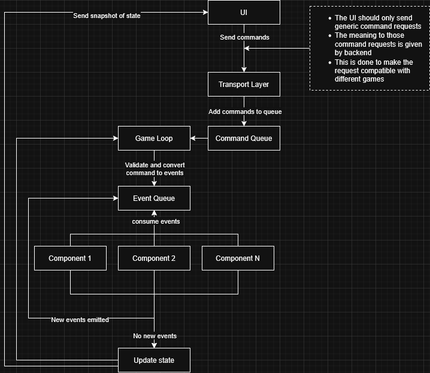
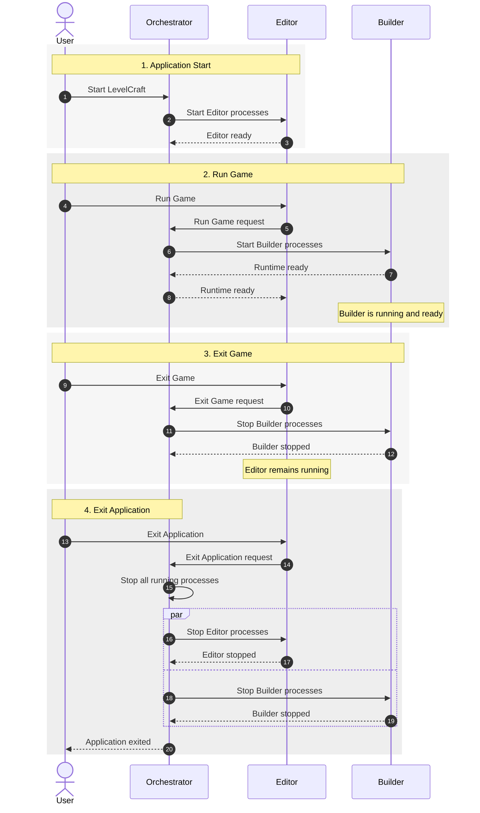

<h1 align="center">LevelCraft</h1>

<p align="center">
  A no code game engine for creating games without having to build the engine yourself.
  <br />
  <strong>Create. Compose. Play.</strong>
</p>

<p align="center">
  <a href="https://github.com/krishnaZawar/LevelCraft/actions/workflows/ci.yaml"></a>
  
  <a href="https://go.dev/"></a>
  <a href="https://www.typescriptlang.org/"></a>
  <a href="https://react.dev/"></a>
  <a href="https://www.electronjs.org/"></a>
  <a href="https://github.com/krishnaZawar/LevelCraft"></a>
</p>

<p align="center">
  <a href="#getting-started">Getting started</a> ·
  <a href="#what-you-can-build-today">Components</a> ·
  <a href="#usage-docs">Usage docs</a> ·
  <a href="#how-it-works">Architecture</a> ·
  <a href="#where-it-stands-today">Status</a>
</p>

---

LevelCraft is built around a simple idea: creators should define games through **entities, components, interactions, rules, and state**, while the engine handles the systems required to build and run them.

The goal is to shorten the distance between an idea and a playable game, giving creators more time to design and iterate and less time engineering the machinery underneath.

## Why LevelCraft?

Creating a game shouldn't begin with building the technology needed to create one.

A simple idea turns into engineering work fast: entities, state, events, persistence, runtime systems, and the infrastructure sitting between an idea and something playable.

LevelCraft moves that complexity **from the creator to the engine**.

The creator should think about:

```text
What exists?
What can happen?
How do things interact?
What makes this game fun?
```
not how to implement the machinery that makes those things possible.

The goal is to make the path from `idea → game → play` shorter, simpler, and more accessible.

```
Less time building the engine. More time building the game.
```

## What you can build today

A game in LevelCraft is a scene of **gameobjects**, each one a name and a set of **components** that give it presence and behaviour.

Four components ship today:

| Component | What it gives an object |
| --- | --- |
| **Transform** | A position and a size in the world. Everything visible needs one. |
| **Color** | A fill colour, so the object can be seen. |
| **InputMovement** | Movement driven by the keys you choose, per axis. |
| **Collider** | A body that collides with other bodies, optionally immovable. |

Compose them and the behaviour follows: a Transform and a Color is scenery, add InputMovement and it is a player, add a Collider to both and they stop passing through each other.

Everything in the editor works against this set, from placing objects on the canvas to editing their attributes and running the game. The set grows as the engine does.

## Getting started

### Prerequisites

| | Version |
| --- | --- |
| [Go](https://go.dev/dl/) | 1.26.1 |
| [Node.js](https://nodejs.org/) | 22 |

### Install

```bash
git clone https://github.com/krishnaZawar/LevelCraft.git
cd LevelCraft

# the editor and player clients
(cd editor/app && npm install)
(cd builder/app && npm install)
```

### Run

The orchestrator is the entry point. It starts every process LevelCraft needs, so this is the only command to run:

```bash
cd orchestrator
go run ./cmd
```

The editor window opens on its own. Closing it shuts the rest down with it.

> The orchestrator resolves the other services by relative path, so run it from the `orchestrator` directory rather than the repository root.

### Run the tests

```bash
# Go services
for mod in $(find . -name go.mod); do (cd $(dirname $mod) && go test ./...); done

# clients
(cd editor/app && npm test)
(cd builder/app && npm test)
```

## See it in action

<!--
  TODO: record a short walkthrough that builds and plays a small game, and
  embed it here. It should cover: create a project, add an object, give it
  Transform, Color and InputMovement, press Run, move the object with the keys.
-->

_A walkthrough video is being recorded and will be linked here._

## Usage docs

Guides for using the engine, covering the editor panels, projects, gameobjects and each component, live in **[user-guide](./user-guide/)**.

| Guide | What it covers |
| --- | --- |
| [Editor](./user-guide/editor.md) | The panels, how to use them, and how to run your game |
| [Projects](./user-guide/projects.md) | Creating a project and what lives inside one |
| [Gameobjects](./user-guide/gameobjects.md) | What they are, their lifecycle, and worked examples |
| [Components](./user-guide/components.md) | Each component, its attributes, and how to use it |

## How it works

LevelCraft is built as a set of cooperating systems with clear responsibilities.

The **Orchestrator is the application entry point**. It starts LevelCraft and manages the lifecycle of the processes that make up the application, including the Editor.

The **Editor** is where the game is authored.

The **Builder** prepares the authored game for execution.

The **Runtime** executes the game.

The goal is for these systems to feel like one application while remaining clearly separated underneath:

```
Create → Build → Play → Iterate
```

### Builder Architecture



### Complete Application Flow



> For the deeper architecture, implementation details, and design decisions, see [docs](./docs/).

## Where It Stands Today

**Early development**

The four application flows above are connected and working: the orchestrator starts the editor, a game runs on request, stopping it leaves the editor alone, and quitting shuts everything down together.

On top of that foundation, the parts a creator actually touches are taking shape:

- **Authoring:** create and open projects, add, duplicate and delete gameobjects, attach and remove components, and edit their attributes
- **Canvas:** an infinite pan and zoom workspace with the game screen marked out, with objects dragged and resized directly on it
- **Running:** Run launches the game in its own player window and Stop returns to the editor, with the scene running from a throwaway copy so playing never overwrites your project
- **Runtime:** a game loop with frame pacing, keyboard input driving movement, and collision detection between bodies

LevelCraft is not production-ready yet. The architecture, APIs, and internal abstractions are expected to evolve as the engine is built and exercised.

What to Expect
- Core systems are actively being developed
- APIs and architecture may change
- The component set is small and growing
- Some functionality is incomplete or experimental
- Documentation will evolve alongside the implementation

The immediate goal is to establish a solid foundation for the no-code game creation experience that LevelCraft is ultimately being built for, while adding components and other directly usable functionalities incrementally.
